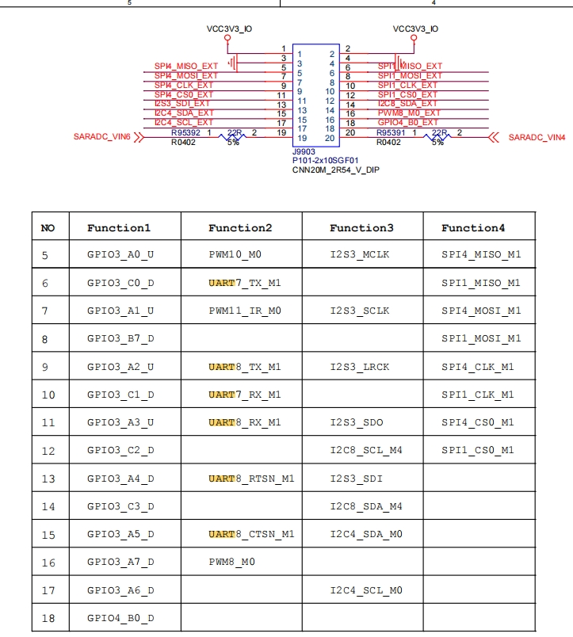
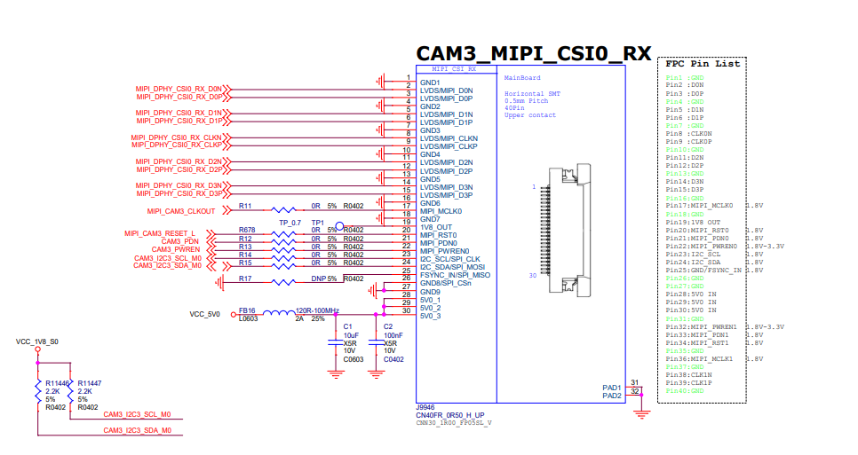
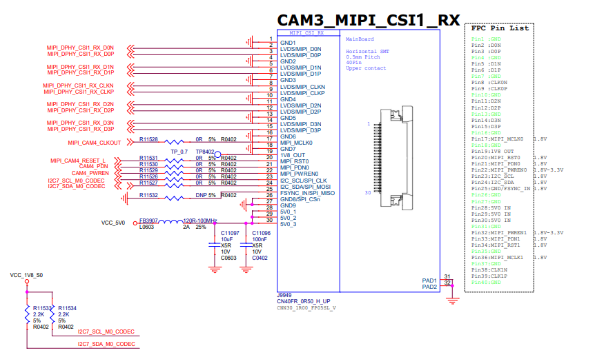
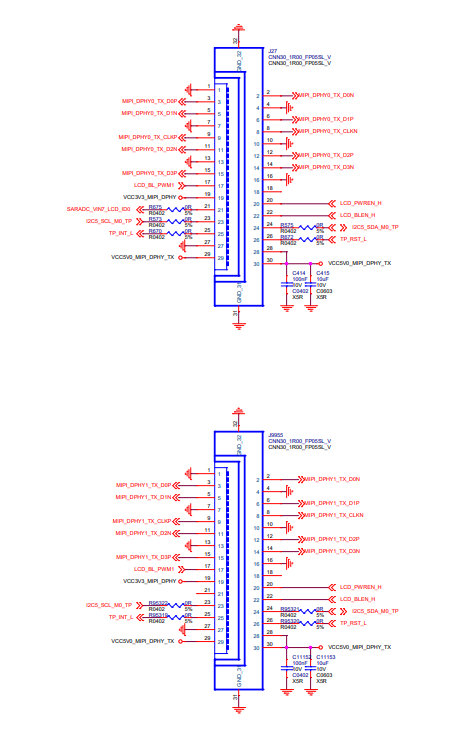

# 四、硬件相关信息

### 4.1 扩展座子引脚定义

开发板提供一个 2×10 扩展座子（位号 `J9903`，连接器型号 `P101-2x10SGF01`，封装 `CNN20M_2R54_V_DIP`，2.54 mm 间距），可引出 SPI、I2S、I2C、UART、PWM、SARADC 及 GPIO 等信号，便于连接自定义模块或外设。座子引脚排布及复用功能如下图所示：

图中给出了扩展 IO 的复用功能表。NO 为图中编号，Function1～Function4 表示同一管脚可配置的不同功能：

| NO | Function1 | Function2 | Function3 | Function4 |
| :--: | --- | --- | --- | --- |
| 5 | GPIO3_A0_U | PWM10_M0 | I2S3_MCLK | SPI4_MISO_M1 |
| 6 | GPIO3_C0_D | UART7_TX_M1 | — | SPI1_MISO_M1 |
| 7 | GPIO3_A1_U | PWM11_IR_M0 | I2S3_SCLK | SPI4_MOSI_M1 |
| 8 | GPIO3_B7_D | — | — | SPI1_MOSI_M1 |
| 9 | GPIO3_A2_U | UART8_TX_M1 | I2S3_LRCK | SPI4_CLK_M1 |
| 10 | GPIO3_C1_D | UART7_RX_M1 | — | SPI1_CLK_M1 |
| 11 | GPIO3_A3_U | UART8_RX_M1 | I2S3_SDO | SPI4_CS0_M1 |
| 12 | GPIO3_C2_D | — | I2C8_SCL_M4 | SPI1_CS0_M1 |
| 13 | GPIO3_A4_D | UART8_RTSN_M1 | I2S3_SDI | — |
| 14 | GPIO3_C3_D | — | I2C8_SDA_M4 | — |
| 15 | GPIO3_A5_D | UART8_CTSN_M1 | I2C4_SDA_M0 | — |
| 16 | GPIO3_A7_D | PWM8_M0 | — | — |
| 17 | GPIO3_A6_D | — | I2C4_SCL_M0 | — |
| 18 | GPIO4_B0_D | — | — | — |

使用时请注意：

- 带 `_M0`、`_M1`、`_M4` 等后缀的功能为管脚复用功能，实际使用前需按所选功能配置 IOMUX。

---

### 4.2 MIPI CSI 摄像头接口（CSI0）

开发板提供两路 MIPI CSI 摄像头接口。第一路（原理图中标识为 `CAM3_MIPI_CSI0_RX`）采用 40Pin、0.5 mm 间距的 FPC 座（位号 `J9946`，型号 `CN40FR_0R50_H_UP`，卧式贴片、上接触），用于连接 MIPI CSI 摄像头模组。座子电路及引脚定义如下图所示：

FPC 排线各引脚定义如下（电平一栏仅在原图有标注时列出）：

| Pin | 信号 | 电平 | Pin | 信号 | 电平 |
| :--: | --- | :--: | :--: | --- | :--: |
| 1 | GND | — | 21 | MIPI_PDN0 | 1.8 V |
| 2 | D0N | — | 22 | MIPI_PWREN0 | 1.8 V～3.3 V |
| 3 | D0P | — | 23 | I2C_SCL | 1.8 V |
| 4 | GND | — | 24 | I2C_SDA | 1.8 V |
| 5 | D1N | — | 25 | GND/FSYNC_IN | 1.8 V |
| 6 | D1P | — | 26 | GND | — |
| 7 | GND | — | 27 | GND | — |
| 8 | CLK0N | — | 28 | 5V0_IN | — |
| 9 | CLK0P | — | 29 | 5V0_IN | — |
| 10 | GND | — | 30 | 5V0_IN | — |
| 11 | D2N | — | 31 | GND | — |
| 12 | D2P | — | 32 | MIPI_PWREN1 | 1.8 V～3.3 V |
| 13 | GND | — | 33 | MIPI_PDN1 | 1.8 V |
| 14 | D3N | — | 34 | MIPI_RST1 | 1.8 V |
| 15 | D3P | — | 35 | GND | — |
| 16 | GND | — | 36 | MIPI_MCLK1 | 1.8 V |
| 17 | MIPI_MCLK0 | 1.8 V | 37 | GND | — |
| 18 | GND | — | 38 | CLK1N | — |
| 19 | 1V8_OUT | 1.8 V | 39 | CLK1P | — |
| 20 | MIPI_RST0 | 1.8 V | 40 | GND | — |

信号可分为以下几类：

- **差分数据与时钟**：`D0N/D0P`、`D1N/D1P`、`D2N/D2P`、`D3N/D3P` 为 4 组 MIPI 差分数据线；`CLK0N/CLK0P`、`CLK1N/CLK1P` 为两组差分时钟。
- **时钟与控制**：`MIPI_MCLK0/1` 为主时钟输入，`MIPI_RST0/1` 为复位，`MIPI_PDN0/1` 为掉电控制，`MIPI_PWREN0/1` 为电源使能，`FSYNC_IN` 为帧同步输入（与 GND 复用，见 Pin25）。
- **配置接口**：`I2C_SCL`、`I2C_SDA` 为 1.8 V 电平，用于配置摄像头传感器寄存器。
- **电源**：`1V8_OUT` 为 1.8 V 输出，`5V0_IN`（Pin28～30）为 5 V 输入；`MIPI_PWREN0/1` 为 1.8 V～3.3 V 兼容电平。

> 说明：接线前请确认 FPC 排线的 1 脚方向及座子接触面（上接触），引脚定义以图中 `FPC Pin List` 为准。

---

### 4.3 MIPI CSI 摄像头接口（CSI1）

开发板还提供第二路 MIPI CSI 摄像头接口（原理图中标识为 `CAM3_MIPI_CSI1_RX`），位号 `J9949`，型号 `CN40FR_0R50_H_UP`，规格与 CSI0 接口一致：40Pin、0.5 mm 间距、卧式贴片、上接触。座子电路及引脚定义如下图所示：

该接口的 FPC 引脚定义与 4.2 节的 CSI0 接口完全相同，可直接使用 4.2 节的引脚表。两路接口的区别在主板侧所接的通道：

- **数据通道**：图中左侧网络名为 `MIPI_DPHY_CSI1_RX_*`（对应 CSI0 接口为 `MIPI_DPHY_CSI0_RX_*`），即接入 SoC 的 CSI1 通道。
- **摄像头控制信号**：`MIPI_CAM4_CLKOUT`、`MIPI_CAM4_RESET_L`、`CAM4_PDN`、`CAM4_PWREN`（对应 CSI0 接口的 CAM3 系列信号）。
- **配置接口**：`I2C7_SCL_M0_CODEC`、`I2C7_SDA_M0_CODEC`（对应 CSI0 接口的 `CAM3_I2C3_SCL_M0`、`CAM3_I2C3_SDA_M0`）。

> 说明：两路接口的 FPC 引脚排列一致，但主板侧资源不同，使用时请以对应的原理图网络名为准。

---

### 4.4 MIPI DSI 显示接口

开发板提供两路 MIPI DSI 显示接口，分别引出 RK3588 的 DPHY0 和 DPHY1 发送通道，可驱动 MIPI 接口的液晶显示屏。两路座子的电路如下图所示（上为 DPHY0，下为 DPHY1）：

两路接口均为 30Pin FPC 座，型号 `CONN30_1R00_FP05SL_V`（具体规格请以连接器手册为准）。两路的基本信息如下：

| 项目 | DPHY0 接口 | DPHY1 接口 |
| --- | --- | --- |
| 连接器位号 | `J27` | `J9955` |
| 数据通道前缀 | `MIPI_DPHY0_TX_*` | `MIPI_DPHY1_TX_*` |

每个接口的信号大致分为以下几类：

- **显示数据**：4 组 MIPI DSI 差分数据对（`D0`～`D3` 的 P/N）及 1 组差分时钟（`CLKP/CLKN`），由对应的 DPHY 通道输出。
- **背光与电源控制**：背光 PWM 调光、背光使能、LCD 电源使能，以及 LCD 电源（3.3 V 与 5 V）。
- **触摸接口**：触摸控制器的 I2C 通信线、中断与复位信号。
- **屏幕识别**：DPHY0 接口（`J27`）可通过 ADC（`SARADC_VIN7_LCD_ID0`）采集 LCD ID 检测电压；DPHY1 接口（`J9955`）对应脚位未接该检测网络。

> 说明：两路接口的 FPC 引脚排列一致，但各自连接不同的 DPHY 通道及外围控制信号，实际接线与引脚网络名请以原理图为准。

---
