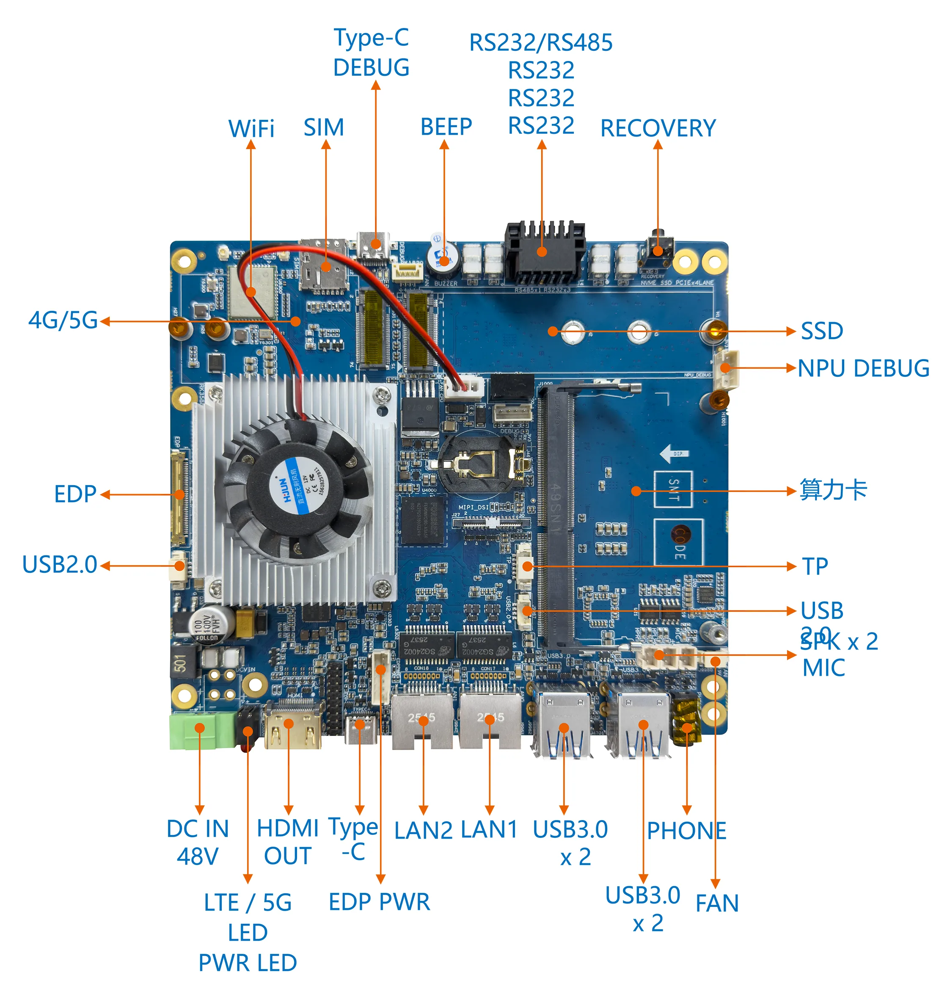
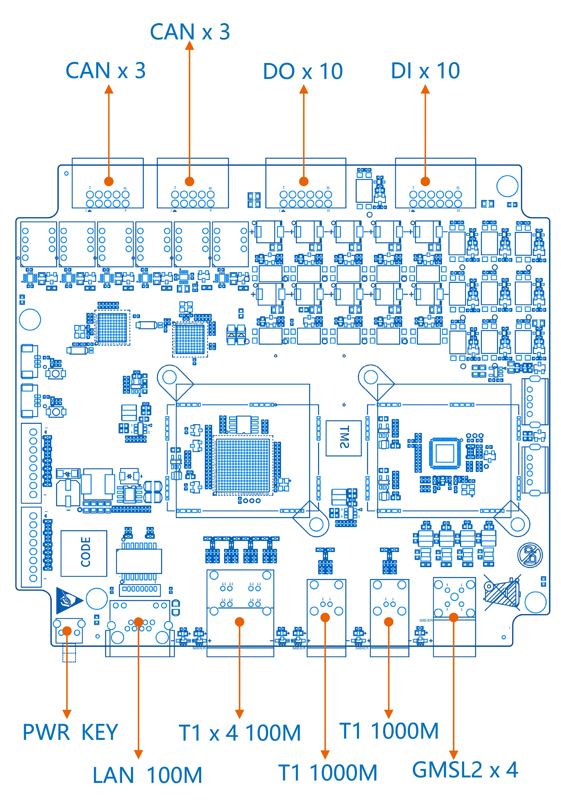
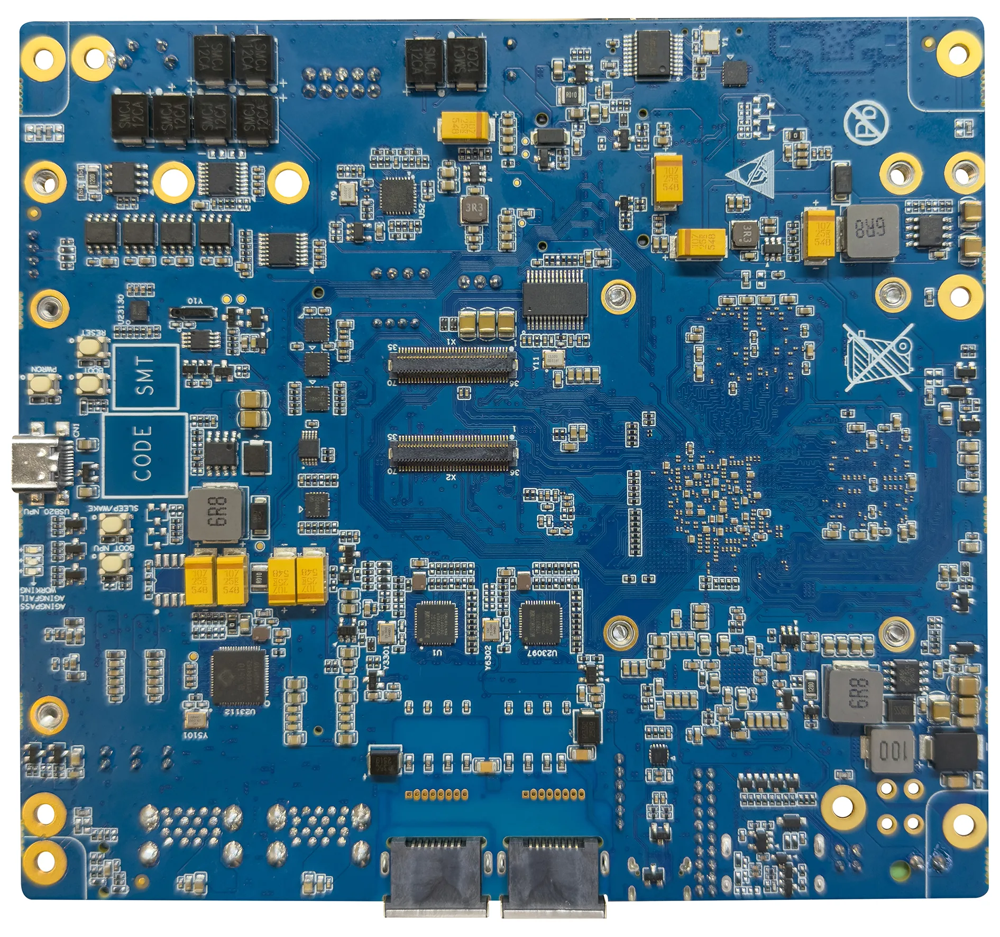
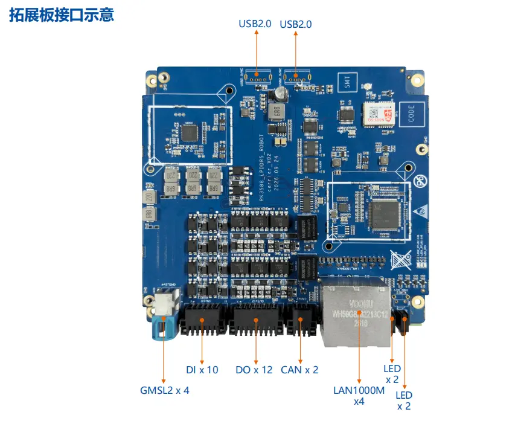

# 一、开发板详情

**1、   贝启Robo3588机器人开发板正面接口示意图**

​																					图2：   贝启Robo3588机器人开发板正面接口示意图

**2、   贝启Robo3588机器人开发板反面接口示意图**

​                                                                           图3：   贝启Robo3588机器人开发板反面接口示意图

**3、 贝启Robo3588机器人拓展板接口示意图**

**4、 贝启Robo3588机器人拓展板示意图**

