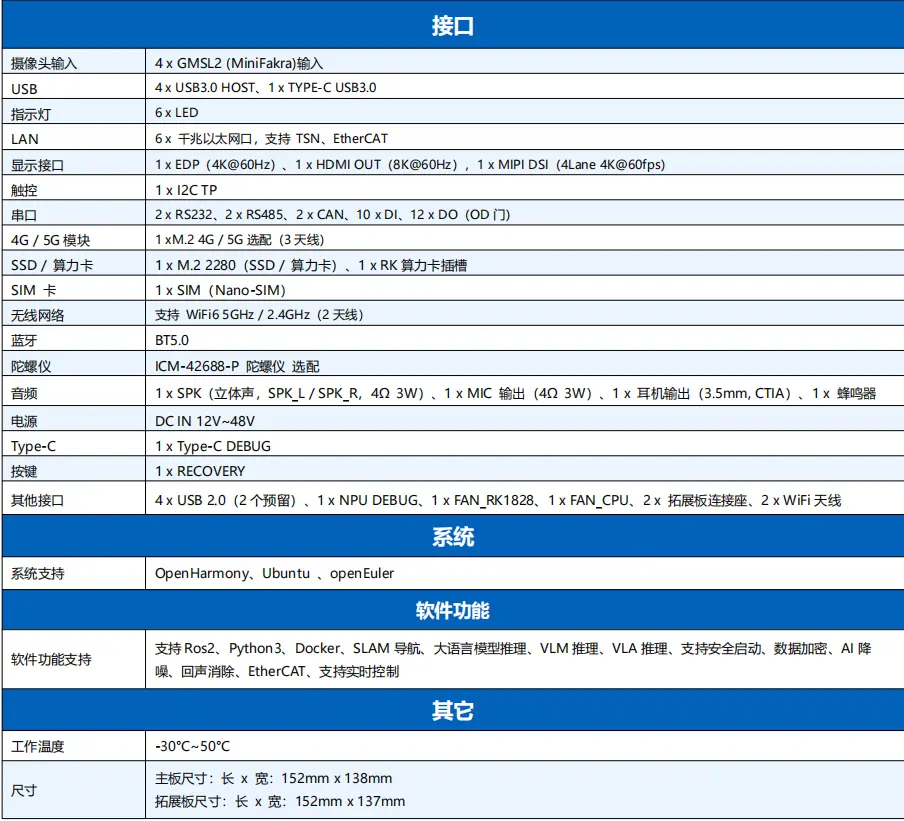

# 二、开发板规格

Rockchip RK3588集成四核Cortex-A76和四核Cortex-A55核心，主频高达2.4GHz，可广泛应用于嵌入式人工智能领域。

Robo3588机器人开发板核心规格如表1所示：

| 芯片、处理器、存储 |  |
| --- | --- |
| SoC | Rockchip RK3588 |
| CPU | ARM Cortex-A76×4+ARM Cortex-A55×4 |
| GPU | G610 支持OpenGLES 1.1, 2.0, and 3.2, OpenCL up to 2.2 and Vulkan1.2，专有2D硬件加速引擎 |
| NPU | 6.0TOPs |
| RAM | 8GB 及以上 LPDDR5 |
| ROM | 64GB eMMC 5.1 |

​																表1    贝启Robo3588机器人开发板核心规格清单

贝启Robo3588机器人开发板接口规格说明如表2所示：

​																表2    贝启Robo3588机器人开发板接口规格说明
